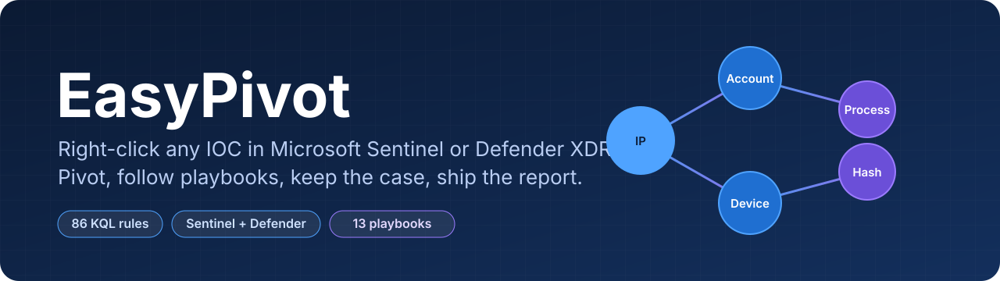
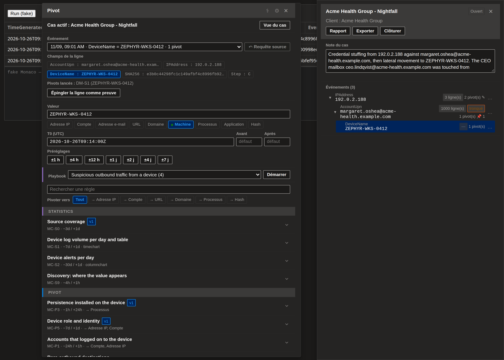
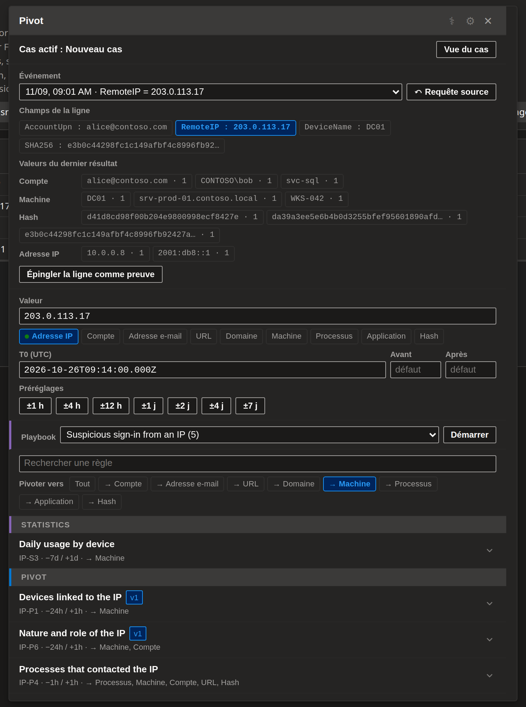
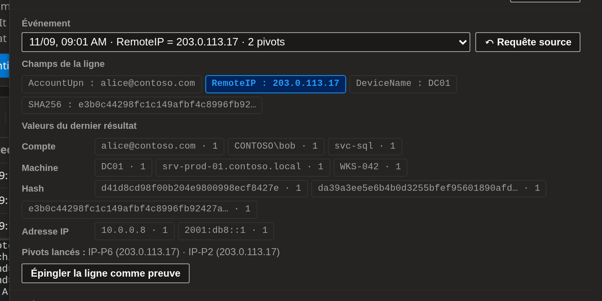
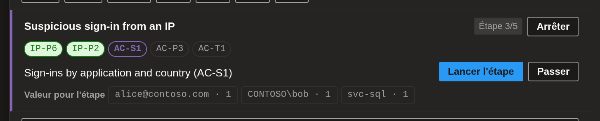
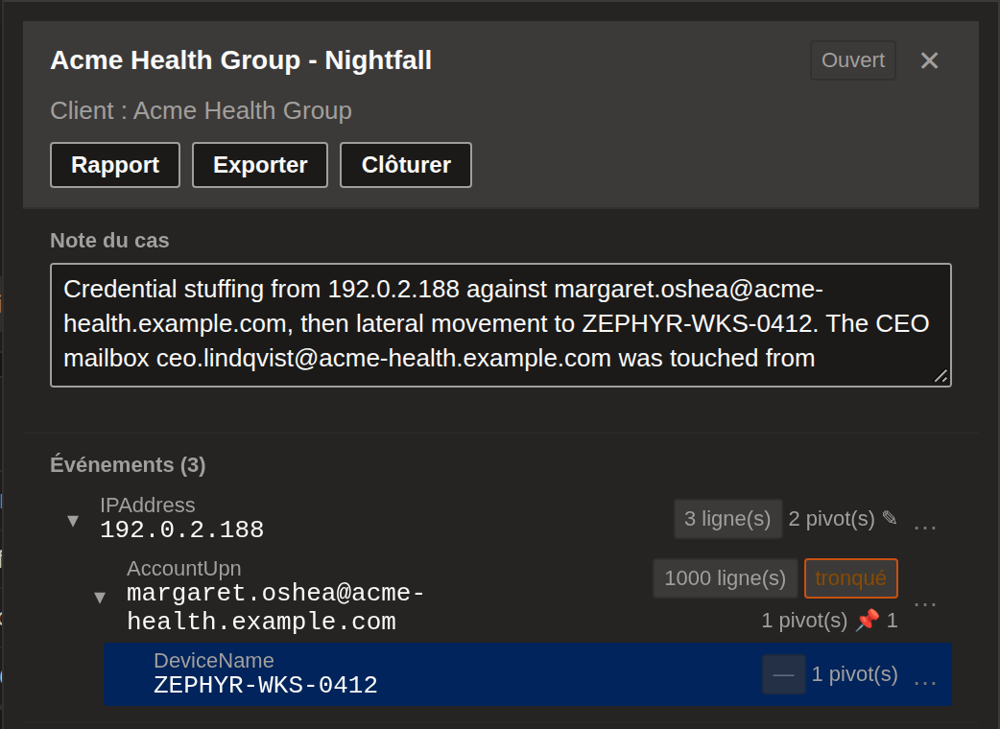
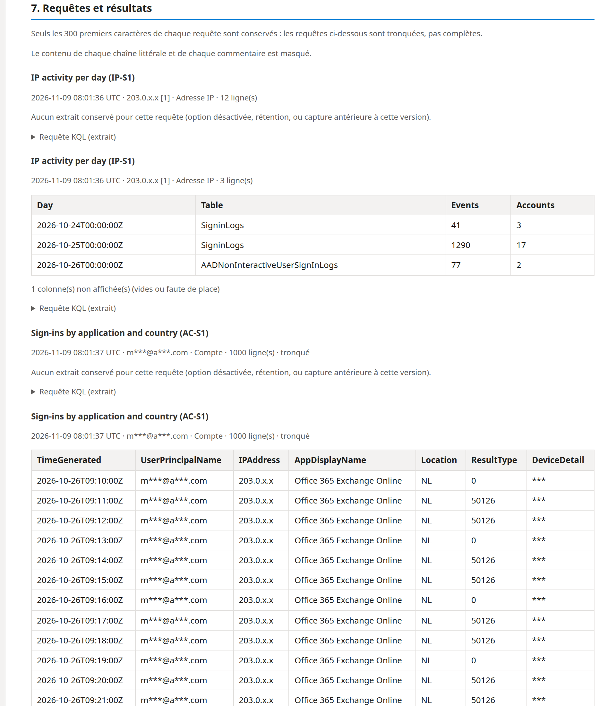
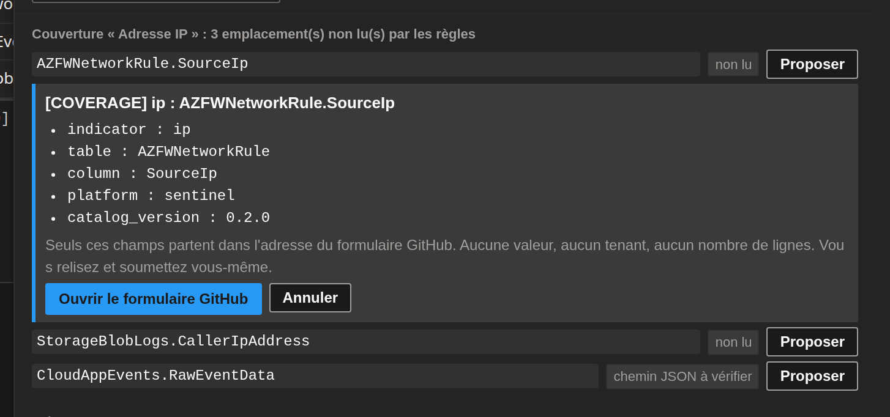
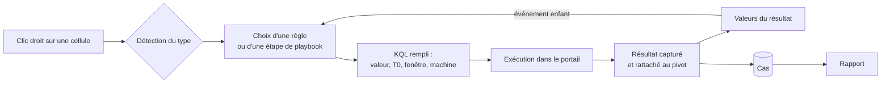

<p align="center">
  
</p>

<p align="center">
  <a href="https://github.com/arthubhub/MicrosoftSentinel-EasyPivot/releases/latest/download/sentinel-easypivot.user.js"></a>
  
  
  
  
</p>

<p align="center">
  <a href="README.md">English</a> · <b>Français</b>
</p>

**EasyPivot** est un userscript Tampermonkey pour les analystes SOC. Clic droit sur une valeur d'un résultat **Microsoft Sentinel** ou de l'**Advanced Hunting de Defender XDR**, choix d'un pivot : la requête KQL, déjà remplie (valeur, fenêtre de temps, machine), arrive dans l'éditeur. Chaque événement, requête et résultat est rangé dans un **cas**, et le cas devient un **rapport** en un clic.

<p align="center">
  
  <br><sub>Panneau Pivot et vue du cas sur une page de requêtage (portail de test, données fictives).</sub>
</p>

## Pourquoi EasyPivot

- **Fini le KQL copié-collé.** 86 règles de pivot ([MSSentinel-PivotRules](https://github.com/arthubhub/MSSentinel-PivotRules)) pour les IP, comptes, e-mails, URL, domaines, machines, processus, applications et hash, chacune en variante Sentinel et Defender XDR.
- **Pivoter d'une entité à l'autre.** IP → machine, compte → IP, machine → compte, hash → machine… chaque règle dit ce que contient son résultat, et le panneau filtre par cible.
- **Suivre un playbook.** 13 scénarios guidés (compte compromis, mouvement latéral, hameçonnage, consentement OAuth, beaconing…) qui reprennent les valeurs du résultat d'une étape pour la suivante.
- **Ne jamais perdre le fil.** Cas par client, historique de chaque événement, arbre des pivots, notes, preuves épinglées et rapport masqué prêt pour le ticket.

## Fonctionnalités

<table>
<tr>
<td width="50%" valign="top">

### Pivoter depuis n'importe quelle cellule
Détection du type (colonnes connues, entités Defender, motifs), normalisation de la valeur (défang, port, `::ffff:`), T0 et machine lus dans la ligne. Règles Statistics / Pivot / Timeline, recherche au clavier, préréglages de ±1 h à ±7 j, et filtre **Pivoter vers**.

</td>
<td width="50%"></td>
</tr>
<tr>
<td width="50%"></td>
<td width="50%" valign="top">

### Valeurs du dernier résultat
Les indicateurs du résultat affiché, regroupés par type et par fréquence. Un clic ouvre un événement enfant du pivot qui a produit ce résultat : l'arbre se construit tout seul.

</td>
</tr>
<tr>
<td width="50%" valign="top">

### Playbooks guidés
Démarrer un scénario pour le type sélectionné : l'étape en cours est mise en avant, la valeur à reprendre est proposée depuis le résultat de l'étape précédente, la progression est gardée dans le cas.

</td>
<td width="50%"></td>
</tr>
<tr>
<td width="50%"></td>
<td width="50%" valign="top">

### Cas, historique et arbre
Les cas sont cloisonnés par tenant Defender ou workspace Sentinel et peuvent relier les deux portails d'un même client. Chaque cellule sur laquelle on ouvre le panneau entre dans l'historique, sans lancer de règle. Notes par nœud, lignes épinglées comme preuves, export et import.

</td>
</tr>
<tr>
<td width="50%" valign="top">

### Rapport en un clic
Markdown ou HTML : synthèse, chronologie, indicateurs, preuves, arbre et notes, puis **chaque requête avec le nom du pivot, la valeur, son type et un extrait de 50 lignes du résultat**. Les requêtes identiques sont regroupées. **Masqué par défaut.**

</td>
<td width="50%"></td>
</tr>
<tr>
<td width="50%"></td>
<td width="50%" valign="top">

### Combler les trous de couverture
La règle Découverte cherche la valeur dans toutes les tables. EasyPivot liste les emplacements que les règles ne lisent pas encore et pré-remplit une issue « source manquante » sur le dépôt de règles (type, table, colonne, plateforme uniquement).

</td>
</tr>
</table>

Et aussi : **requêtes de contexte en arrière-plan** en option (lancer une règle sans toucher l'éditeur), liens Threat Intel (VirusTotal, AbuseIPDB, urlscan, Shodan, personnalisés ; désactivés par défaut), diagnostic de santé, interface en français et en anglais.

## Comment ça marche



## Playbooks

| | Scénario | Départ | Étapes |
| --- | --- | --- | --- |
| S1 | Connexion suspecte depuis une IP | IP | nature de l'IP → comptes → habitudes → actions d'admin → chronologie |
| S2 | Compte compromis | Compte | profil → IP et appareils → règles de boîte, consentements, MFA → machines → chronologie |
| S3 | Exécution suspecte sur une machine | Machine | rôle → comptes → téléchargé puis exécuté → même fichier ailleurs → persistance |
| S4 | Hameçonnage | E-mail | messages → URL et pièces jointes → qui a cliqué → sa chronologie |
| S5 | Domaine malveillant | Domaine | prévalence → DNS → machines et processus → chronologie |
| S6 | Mouvement latéral depuis une machine | Machine | comptes → où ils sont allés → fichiers et partages → chronologie |
| S7 | Fichier malveillant | Hash | prévalence → origine → machines → persistance → chronologie |
| S8 | Consentement OAuth malveillant | Application | consentements et secrets → service principal → utilisateurs → règles de boîte → actions |
| S9 | Beaconing vers un serveur de commande | IP | nature → processus appelant → parents/enfants → persistance → chronologie |
| S10 | Password spray ou force brute | IP | comptes par jour → dans le temps → qui a réussi → échecs → risque Entra |
| S11 | Compte signalé à risque par Entra ID | Compte | risque → habitudes → IP → nature de l'IP → autres comptes |
| S12 | Exfiltration de données par un compte | Compte | fichiers et partages → fichiers cloud → messages → IP → services cloud |
| S13 | Communication sortante suspecte d'une machine | Machine | destinations rares → prévalence → autres machines → chronologie |

## Dans le vrai portail

| Choisir un indicateur | Menu Pivot | Résultat |
| --- | --- | --- |
|  |  |  |

Passer sur Defender en gardant tout l'historique et le contexte :


## Confidentialité dès la conception

- Rien ne quitte le navigateur sans clic : rapport, export, issue de couverture et liens Threat Intel sont des actions explicites.
- Aucun jeton, cookie ni en-tête `Authorization` n'est stocké ni journalisé. Avec les requêtes en arrière-plan, les en-têtes de la page restent en mémoire, le temps de la session seulement.
- Les résultats capturés restent dans le stockage local de Tampermonkey, avec purge automatique et masquage optionnel à l'enregistrement.
- Les tables personnalisées `_CL` n'apparaissent dans aucun rapport ni aucune issue.

## Installation

1. Installer [Tampermonkey](https://www.tampermonkey.net/).
2. Cliquer sur **[Installer le userscript](https://github.com/arthubhub/MicrosoftSentinel-EasyPivot/releases/latest/download/sentinel-easypivot.user.js)**.
3. Ouvrir la recherche de journaux de Sentinel ou l'Advanced Hunting de Defender, puis faire un clic droit sur une cellule de résultat.

Le catalogue de règles est téléchargé depuis la dernière release de [MSSentinel-PivotRules](https://github.com/arthubhub/MSSentinel-PivotRules), validé (un catalogue cassé est refusé), mis en cache 12 h, et embarqué pour le premier démarrage. Noms des règles et des scénarios, descriptions et aides à la lecture sont rédigés en anglais, quelle que soit la langue de l'interface. L'URL se change dans Paramètres.

## Développement

```
npm install
npm run sync-rules   # copie ../MSSentinel-PivotRules/dist/pivot-rules.json
npm run check        # types + build -> dist/sentinel-easypivot.user.js
npm run harness && node harness/drive.mjs harness/scenarios/<scénario>.mjs
```

Le harness rend le panneau dans un faux portail (Chromium headless) et déroule 13 scénarios : il prouve les chemins de code, pas les sélecteurs du vrai portail. Captures du README : `LANG_SHOTS=fr node harness/drive.mjs harness/readme/shots.mjs`.

À chaque merge sur `master`, une release contenant `sentinel-easypivot.user.js` est publiée.

## Crédits

Ce projet est un fork de [MicrosoftSentinel-Userscript](https://github.com/LasCC/MicrosoftSentinel-Userscript) de **LasCC**, sans qui il n'existerait pas : intégration au portail, pont vers l'éditeur Monaco, thème et composants d'interface viennent de ce travail.
