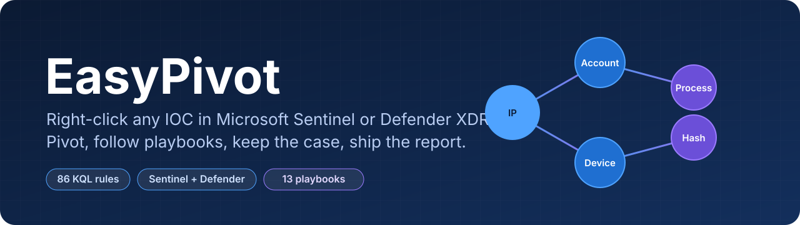
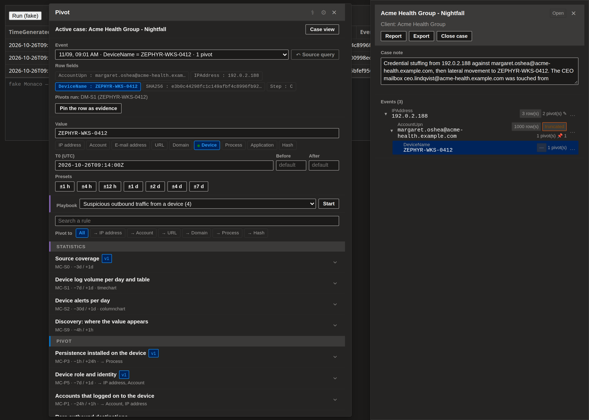
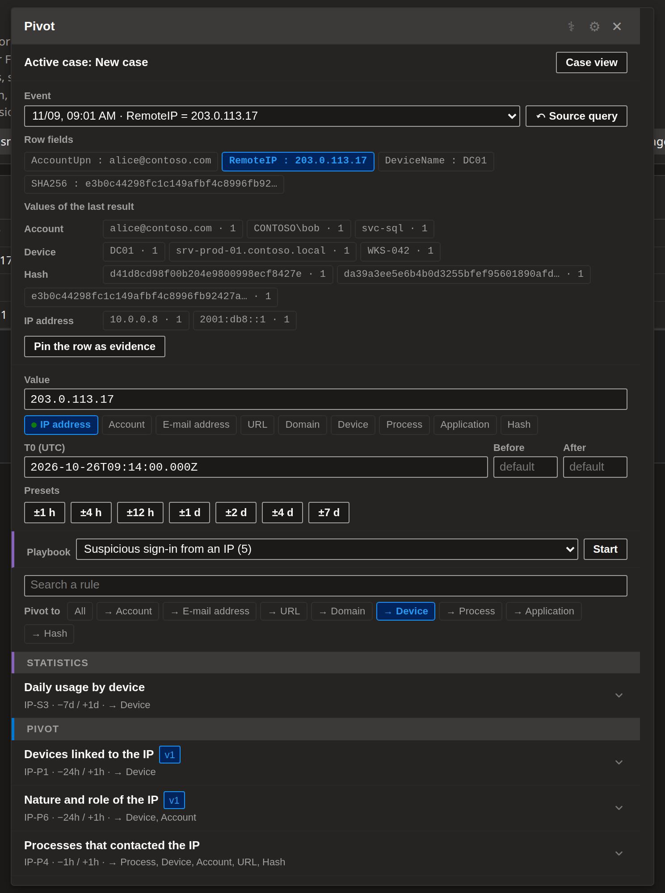
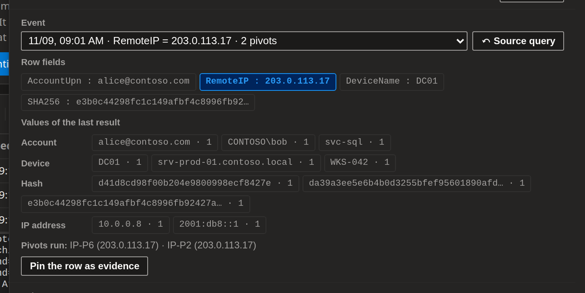
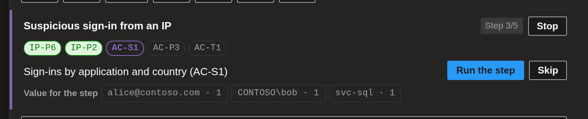
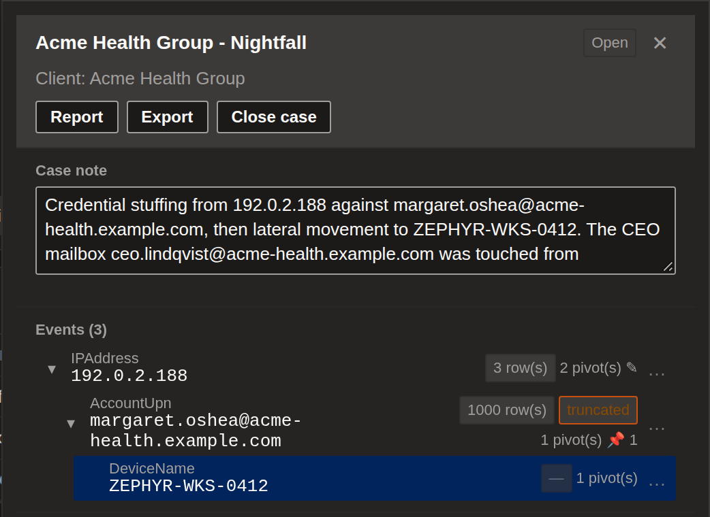
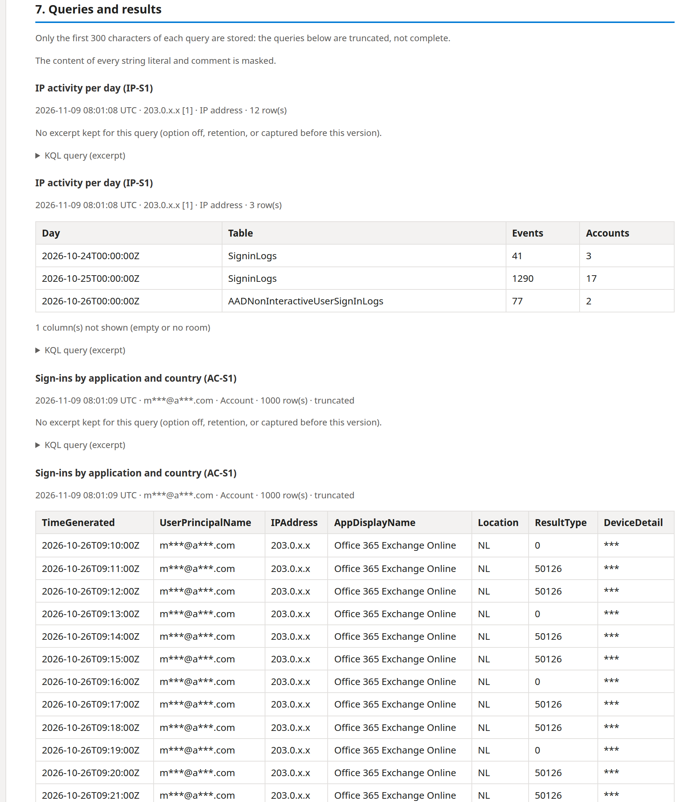
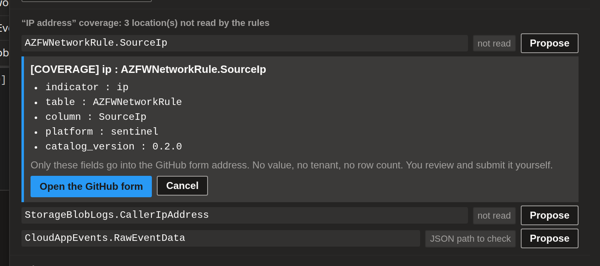
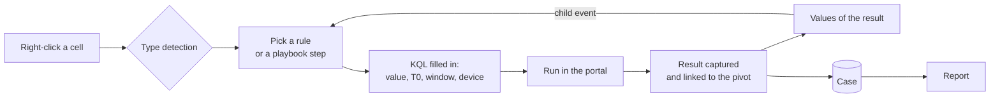

<p align="center">
  
</p>

<p align="center">
  <a href="https://github.com/arthubhub/MicrosoftSentinel-EasyPivot/releases/latest/download/sentinel-easypivot.user.js"></a>
  
  
  
  
</p>

<p align="center">
  <b>English</b> · <a href="README.fr.md">Français</a>
</p>

**EasyPivot** is a Tampermonkey userscript for SOC analysts. Right-click any value in a **Microsoft Sentinel** or **Defender XDR advanced hunting** result, pick a pivot, and a ready-to-run KQL query (value, time window, device already filled in) lands in the editor. Every event, query and result is kept in a **case**, and the case becomes a **report** in one click.

<p align="center">
  
  <br><sub>Pivot panel and case view on a hunting page (test portal, fictitious data).</sub>
</p>

## Why EasyPivot

- **No more copy-paste KQL.** 86 curated pivot rules ([MSSentinel-PivotRules](https://github.com/arthubhub/MSSentinel-PivotRules)) for IPs, accounts, e-mails, URLs, domains, devices, processes, applications and hashes, each with a Sentinel and a Defender XDR variant.
- **Pivot across entities.** IP → device, account → IP, device → account, hash → device… every rule says what its result contains, and the panel filters by target.
- **Follow a playbook.** 13 guided scenarios (compromised account, lateral movement, phishing, OAuth consent, beaconing…) that carry values from one step's result to the next.
- **Never lose the thread.** Cases per customer, history of every event, a tree of pivots, notes, pinned evidence, and a masked report ready for the ticket.

## Features

<table>
<tr>
<td width="50%" valign="top">

### Pivot from any cell
Type detection (known columns, Defender entities, patterns), value normalization (refang, port, `::ffff:`), T0 and device read from the row. Rules grouped by Statistics / Pivot / Timeline, keyboard search, presets from ±1 h to ±7 d, and a **Pivot to** filter.

</td>
<td width="50%"></td>
</tr>
<tr>
<td width="50%"></td>
<td width="50%" valign="top">

### Values of the last result
The indicators found in the result you are looking at, grouped by type and frequency. One click opens a child event of the pivot that produced the result: the tree builds itself.

</td>
</tr>
<tr>
<td width="50%" valign="top">

### Guided playbooks
Start a scenario for the selected type: the current step is highlighted, the value to carry is suggested from the previous step's result, and progress is saved in the case.

</td>
<td width="50%"></td>
</tr>
<tr>
<td width="50%"></td>
<td width="50%" valign="top">

### Cases, history and tree
Cases are partitioned per Defender tenant or Sentinel workspace and can link both portals for one customer. Every cell you open the panel on enters the history, no rule needed. Notes per node, pinned evidence rows, export and import.

</td>
</tr>
<tr>
<td width="50%" valign="top">

### One-click report
Markdown or HTML: summary, timeline, indicators, evidence, tree and notes, then **every query with the pivot name, the value, its type and a 50-row results excerpt**. Identical queries are grouped. **Masked by default.**

</td>
<td width="50%"></td>
</tr>
<tr>
<td width="50%"></td>
<td width="50%" valign="top">

### Close coverage gaps
The discovery rule looks for the value in every table. EasyPivot lists the locations the rules do not read yet and prefills a "missing source" issue on the rules repo (type, table, column, platform only).

</td>
</tr>
</table>

Also: optional **background context queries** (run a rule without touching the editor), Threat Intel links (VirusTotal, AbuseIPDB, urlscan, Shodan, custom; off by default), health diagnostics, English and French UI.

## How it works



## Playbooks

| | Scenario | Starts from | Steps |
| --- | --- | --- | --- |
| S1 | Suspicious sign-in from an IP | IP | nature of the IP → accounts → habits → admin actions → timeline |
| S2 | Compromised account | Account | profile → IPs and devices → mailbox rules, consents, MFA → devices → timeline |
| S3 | Suspicious execution on a device | Device | role → accounts → downloaded then run → same file elsewhere → persistence |
| S4 | Phishing | E-mail | messages → URLs and attachments → who clicked → their timeline |
| S5 | Malicious domain | Domain | prevalence → DNS → devices and processes → timeline |
| S6 | Lateral movement from a device | Device | accounts → where they went → files and shares → timeline |
| S7 | Malicious file | Hash | prevalence → origin → devices → persistence → timeline |
| S8 | Malicious OAuth consent | App | consents and secrets → service principal → users → mailbox rules → actions |
| S9 | Beaconing to a C2 server | IP | nature → calling process → parent/child → persistence → timeline |
| S10 | Password spray or brute force | IP | accounts per day → over time → who succeeded → failures → Entra risk |
| S11 | Account flagged at risk by Entra ID | Account | risk → habits → IPs → nature of the IP → other accounts |
| S12 | Data exfiltration by an account | Account | files and shares → cloud file actions → messages → IPs → cloud services |
| S13 | Suspicious outbound traffic from a device | Device | rare destinations → prevalence → other devices → timeline |

## In the real portal

| Select an indicator | Pivot menu | Result |
| --- | --- | --- |
|  |  |  |

Switch to Defender and keep the whole history and context:


## Privacy by design

- Nothing leaves the browser without a click: report, export, coverage issue and Threat Intel links are explicit actions.
- No token, cookie or `Authorization` header is ever stored or logged. With background queries on, the page's request headers stay in memory for the session only.
- Captured results stay in Tampermonkey's local storage, with automatic purge and optional masking at storage time.
- Custom `_CL` tables never appear in a report or an issue.

## Install

1. Install [Tampermonkey](https://www.tampermonkey.net/).
2. Click **[Install the userscript](https://github.com/arthubhub/MicrosoftSentinel-EasyPivot/releases/latest/download/sentinel-easypivot.user.js)**.
3. Open Sentinel logs or Defender advanced hunting, and right-click a result cell.

The rules catalog is downloaded from the latest [MSSentinel-PivotRules](https://github.com/arthubhub/MSSentinel-PivotRules) release, validated (a broken catalog is rejected), cached for 12 h, and bundled for the first start. Rule and scenario names, descriptions and reading hints are written in English, whatever the interface language.

## Development

```
npm install
npm run sync-rules   # copies ../MSSentinel-PivotRules/dist/pivot-rules.json
npm run check        # types + build -> dist/sentinel-easypivot.user.js
npm run harness && node harness/drive.mjs harness/scenarios/<scenario>.mjs
```

The harness renders the panel in a fake portal (headless Chromium) and runs 13 scenarios: it proves the code paths, not the real portal's selectors. README screenshots: `LANG_SHOTS=en node harness/drive.mjs harness/readme/shots.mjs`.

Each merge to `master` publishes a release with `sentinel-easypivot.user.js`.

## Credits

Fork of [MicrosoftSentinel-Userscript](https://github.com/LasCC/MicrosoftSentinel-Userscript) by **LasCC**: portal integration, Monaco bridge, theme and UI components come from that project.
